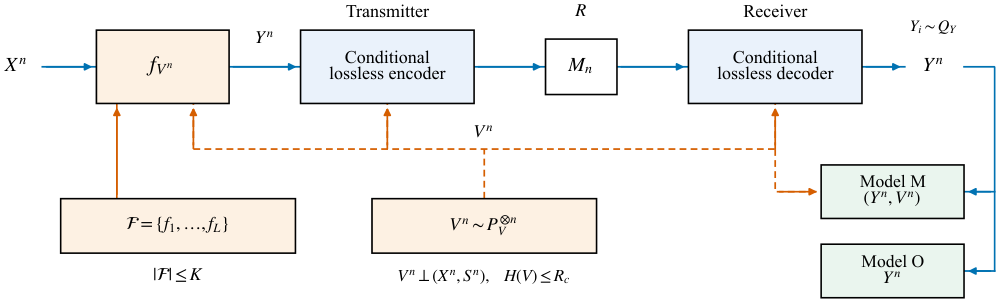
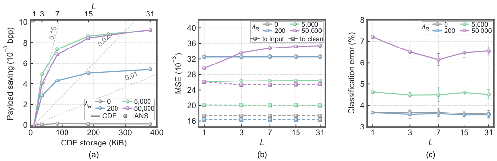

<div align="center">

# Finite-Mode Semantic Coding for Edge IoT

**Target Distribution · Finite Mapping Libraries · Shared Randomness**

Yuning Zhou<sup>1,2</sup>, Yunkai Wang<sup>1</sup>, Zhilan Lu<sup>1</sup>, Ziwei Li<sup>1</sup>,<br>
Feng Bao<sup>1</sup>, Chao Shen<sup>1</sup>, Junwen Zhang<sup>1</sup>, and Nan Chi<sup>1</sup>

<sup>1</sup> Fudan University &nbsp; <sup>2</sup> Shanghai Innovation Institute

[](https://doi.org/10.5281/zenodo.23774113)
[](requirements.txt)
[](LICENSE)
[](LICENSE-DATA.md)

[Overview](#overview) · [Quick start](#quick-start) · [Models](#pretrained-models) · [MNIST](#mnist-experiments) · [Citation](#citation) · [中文](README_zh-CN.md)

</div>

Official code and reproducibility resources for **Finite-Mode Semantic Coding
for Edge IoT under Target Distribution and Shared-Randomness Constraints**.

## Overview

How do a finite library of deterministic mappings and a shared-randomness budget
shape semantic coding? This project studies their joint effect on target
distributions, task constraints, and communication cost, with exact finite-mode
optimization and an executable neural-coding example.

<p align="center">
  
</p>

- **Theory:** Bernoulli optimizers, finite-alphabet examples, strict mode-gain
  certificates, and shared-randomness sampling.
- **Coding:** paired marginal and conditional rANS using the same quantized
  symbols and reconstructions.
- **Resources:** trained MNIST models, CDF storage, endpoint state, and recorded
  batch-one encoding and decoding latency.
- **Reproduction:** source data and runnable tools for the paper's numerical
  figures and tables.

## Quick start

Clone the repository and install the core dependencies with Python 3.11 or newer:

```bash
git clone https://github.com/SII-Yuning-Zhou/finite-mode-semantic-coding.git
cd finite-mode-semantic-coding
python -m venv .venv
# Activate .venv for your operating system, then:
python -m pip install -r requirements.txt
python run_reproduction.py
```

This command checks the theoretical examples and released measurements,
rebuilds the tables, and generates the numerical figures in `outputs/`.
It runs on CPU with the core dependencies. Neural evaluation and new training
are separate commands below.

Useful individual commands:

```bash
python -m theory.verify
python -m reproduce.figures --output outputs/figures
python -m reproduce.tables --output outputs/tables
python run_reproduction.py --tests --skip-plots
```

## Pretrained models

The repository includes four MNIST codec checkpoints and a trained grayscale
classifier. The codec objective weights are **0, 200, 5,000, and 50,000**.

```bash
python mnist.py list-models
```

The complete **v1.0.0** model-and-data archive is available from
[GitHub Releases](https://github.com/SII-Yuning-Zhou/finite-mode-semantic-coding/releases/tag/v1.0.0)
and [Zenodo](https://doi.org/10.5281/zenodo.23774113).
The archived release is fixed; clone the repository for the current convenience
commands shown here.

## MNIST experiments

Install a compatible PyTorch/torchvision build for your machine, followed by:

```bash
python -m pip install -r neural/requirements.txt
python mnist.py --help
```

Use the project-level interface for model evaluation, endpoint profiling, and
training. Command options and complete reproduction recipes are in the
[MNIST guide](docs/NEURAL_REPRODUCTION.md).

```bash
# Evaluate a released codec.
python mnist.py evaluate --rate-weight 5000 --device cuda:0

# Measure batch-one encoding and decoding on CPU.
python mnist.py profile --rate-weight 5000 --device cpu
```

<p align="center">
  
</p>

The supplied results pair marginal and conditional entropy coding at fixed
model weights and offset schedules. The archive contains all schedule
repetitions, original timing samples, and the data underlying these plots.

## Repository structure

```text
theory/               Finite-mode models, optimizers, and certificates
neural/               MNIST codec and conditional entropy coding
configs/              Experiment configurations
data/                 Numerical results and figure source data
results/              Trained checkpoints and endpoint measurements
reproduce/            Figure and table generation
figures/publication/  Paper figures
tests/                Regression tests
docs/                 Experiment and reproduction guides
validation/           Recorded validation results
mnist.py              MNIST experiment interface
run_reproduction.py   End-to-end numerical reproduction
```

**Documentation:** [Theory](docs/THEORY_REPRODUCTION.md) ·
[MNIST](docs/NEURAL_REPRODUCTION.md) ·
[Figures and tables](docs/FIGURE_REPRODUCTION.md) ·
[Environment](docs/ENVIRONMENT.md) ·
[Validation](validation/validation_report.json)

## Citation

Please cite the versioned code and reproducibility release:

```bibtex
@software{zhou2026finite_mode,
  author    = {Zhou, Yuning and Wang, Yunkai and Lu, Zhilan and Li, Ziwei and
               Bao, Feng and Shen, Chao and Zhang, Junwen and Chi, Nan},
  title     = {Finite-Mode Semantic Coding for Edge IoT under Target Distribution
               and Shared-Randomness Constraints - Code and Reproducibility Data},
  year      = {2026},
  version   = {1.0.0},
  publisher = {Zenodo},
  doi       = {10.5281/zenodo.23774113},
  url       = {https://doi.org/10.5281/zenodo.23774113}
}
```

## License and acknowledgements

Original code and usage documentation use the [MIT license](LICENSE).
Author-generated data, trained weights, and figures use
[CC BY 4.0](LICENSE-DATA.md).

The neural implementation uses PyTorch, torchvision, and CompressAI. Dependencies
and external datasets retain their original licenses; see
[third-party notices](THIRD_PARTY_NOTICES.md).
