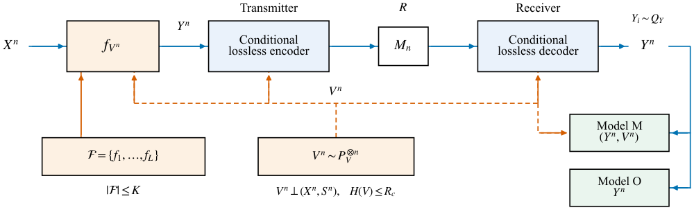

<div align="center">

# 面向边缘物联网的有限模式语义编码

**目标分布 · 有限映射库 · 共享随机性**

[English](README.md) · [代码与数据 DOI](https://doi.org/10.5281/zenodo.23774113) · [模型与完整发布包](https://github.com/SII-Yuning-Zhou/finite-mode-semantic-coding/releases/tag/v1.0.0)

</div>

论文 **Finite-Mode Semantic Coding for Edge IoT under Target Distribution and
Shared-Randomness Constraints** 的官方代码与复现材料。

作者：Yuning Zhou、Yunkai Wang、Zhilan Lu、Ziwei Li、Feng Bao、Chao Shen、Junwen Zhang、Nan Chi。

单位：Fudan University；Yuning Zhou 同时隶属 Shanghai Innovation Institute。

## 项目概览

本项目研究有限确定性映射库与共享随机性预算如何共同影响目标分布、任务约束和通信成本。
代码包含精确有限模式优化、合成源数值验证，以及可执行的 MNIST 条件熵编码实验。

<p align="center">
  
</p>

- **理论求解：** Bernoulli 优化器、有限字母源例子、严格模式增益证书和随机采样。
- **神经编码：** 使用相同量化符号与重建结果，对比边缘和条件 rANS 码流。
- **端点资源：** 提供训练权重、CDF 存储、端点状态及 batch-one 编解码时延记录。
- **图表复现：** 提供数值源数据与论文图表生成入口。

## 快速开始

使用 Python 3.11 或更新版本，在独立虚拟环境中运行：

```bash
git clone https://github.com/SII-Yuning-Zhou/finite-mode-semantic-coding.git
cd finite-mode-semantic-coding
python -m venv .venv
# 按操作系统激活 .venv 后：
python -m pip install -r requirements.txt
python run_reproduction.py
```

该命令在 CPU 上检查理论例子与已发布观测，重建表格并生成数值图，结果写入 `outputs/`。
完整神经评估、新训练和新设备测量通过下面的独立入口执行。

```bash
python -m theory.verify
python -m reproduce.figures --output outputs/figures
python -m reproduce.tables --output outputs/tables
```

## 模型与 MNIST 实验

随库提供四个 codec checkpoint 和一个灰度分类器；四个 codec 的目标权重为 0、200、5,000、50,000。

```bash
python mnist.py list-models
```

先安装适配本机的 PyTorch/torchvision，再安装可选依赖：

```bash
python -m pip install -r neural/requirements.txt
python mnist.py --help
```

具体评估、端点 profiling 和训练命令见 [MNIST 使用指南](docs/NEURAL_REPRODUCTION.md)。
`main` 分支提供当前便利入口；已发布的 `v1.0.0` ZIP 和 Zenodo 归档保持固定。

## 文档与引用

[理论](docs/THEORY_REPRODUCTION.md) · [MNIST](docs/NEURAL_REPRODUCTION.md) ·
[图表](docs/FIGURE_REPRODUCTION.md) · [环境](docs/ENVIRONMENT.md) ·
[验证记录](validation/validation_report.json)

代码与复现材料 DOI：**[10.5281/zenodo.23774113](https://doi.org/10.5281/zenodo.23774113)**。
引用信息与 BibTeX 见 [英文首页](README.md#citation) 和 [CITATION.cff](CITATION.cff)。

原代码与使用文档采用 [MIT](LICENSE)；作者生成的数据、训练权重与图稿采用
[CC BY 4.0](LICENSE-DATA.md)。PyTorch、torchvision、CompressAI 及外部数据保留原许可，
详见 [第三方说明](THIRD_PARTY_NOTICES.md)。
